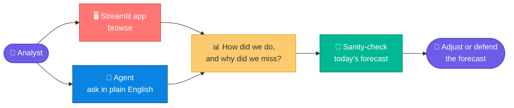
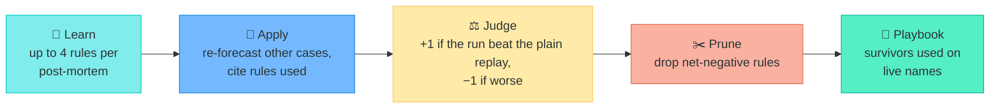
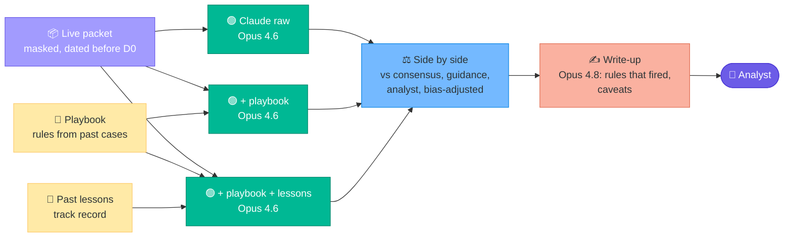

# 🔍 Decision Post-Mortem

### *Learning from our own forecasting misses, without hindsight.*

**Parnassus Hackathon · Snowflake x Anthropic**

[🧭 What we built](#-what-we-built) · [🗺️ User flow](#️-user-flow) · [🔄 How it works](#-how-it-works) · [📊 Results](#-results-at-a-glance) · [✅ Evals](#-evaluations) · [📁 Repo](#-repository-layout)

---

## 🧭 What we built

### 😟 The problem

Every investment review rests on a revenue forecast, and those forecasts drive real decisions. Yet:

| | |
|---|---|
| 📉 **Nobody keeps score** | We project revenue three years out in every review, but rarely compare the numbers with what the company later reported. |
| 🔮 **Hindsight distorts the lesson** | When we do look back, knowing the ending makes every miss look obvious. We blame events nobody could have seen, and overlook the signals that were in front of us. |
| 🧠 **Lessons don't compound** | What we learn stays in people's heads, untested, and never reaches the next review. The same habits, such as anchoring to management's guidance, repeat. |
| 🤖 **AI alone doesn't fix it** | A model trained after the results came out "forecasts" from memory. Its backtest looks brilliant and means nothing. |

### 💡 The idea

> [!TIP]
> **To learn from a forecast, you need a judge who doesn't know how the story ended.**
>
> People can't un-know an outcome. A model can be chosen, and tested, so that it doesn't know it.

### 🛠️ How we solved it

| Problem | What we did |
|---|---|
| 📉 Nobody keeps score | Scored our forecasts, Claude's, consensus and guidance against reported revenue |
| 🔮 Hindsight | Rebuilt five past reviews with only what was known on the review date |
| 🤖 Model memory | Masked names, dates, years and amounts; used Claude Opus 4.6 (older training cutoff) and tested it for recall |
| ⚖️ Unfair blame | Sorted every finding into *we had it*, *we could have got it*, or *nobody could have known*. Only the first becomes a lesson |
| 🧠 Lessons don't compound | Turned lessons into rules, kept only the ones that improved forecasts on cases they never saw |
| 🚦 Lessons never reused | Applied the surviving rules to a live review, in a Streamlit app and a Cortex Agent |

> [!IMPORTANT]
> **Everything is masked.** Companies are `Company_A`, dates are `D-30` (days before the review), years are
> `FY+1`, and amounts are scaled. The tools won't guess who a company is or give buy/sell advice.

---

## 🗺️ User flow

App tabs: How did we do · Where each went wrong · Institutional biases · Learning loop · Live sanity check · Evals.

---

## 🔄 How it works

```mermaid
flowchart LR
    P["1️⃣ Prep<br/>rebuild each review<br/>as it stood"]:::s1 --> M["2️⃣ Mask<br/>hide names, dates,<br/>years, amounts"]:::s2
    M --> R["3️⃣ Replay<br/>Claude re-forecasts<br/>from the packet"]:::s3
    R --> S["4️⃣ Score<br/>every forecast vs<br/>reported revenue"]:::s4
    S --> PM["5️⃣ Post-mortem<br/>every miss,<br/>sorted three ways"]:::s5
    PM --> L["6️⃣ Learn & check<br/>rules tested<br/>leave-one-out"]:::s6
    L --> LV["🚦 Live sanity check<br/>surviving rules meet<br/>a review made today"]:::live
    L -. "new outcomes add<br/>rules and evidence" .-> PM

    classDef s1 fill:#74B9FF,stroke:#0984E3,color:#2d3436
    classDef s2 fill:#A29BFE,stroke:#6C5CE7,color:#2d3436
    classDef s3 fill:#FD79A8,stroke:#E84393,color:#2d3436
    classDef s4 fill:#FFEAA7,stroke:#FDCB6E,color:#2d3436
    classDef s5 fill:#FAB1A0,stroke:#E17055,color:#2d3436
    classDef s6 fill:#55EFC4,stroke:#00B894,color:#2d3436
    classDef live fill:#00B894,stroke:#00866B,color:#fff
```

**1️⃣ Prep.** Five past reviews, none a current holding. Each case is a packet: the review and its FY+1 to FY+3
projections, documents, FactSet consensus (day before the review), guidance, and reported revenue to date.
Nothing is dated on or after the review. Later results sit in a separate schema the forecaster can't read.

**2️⃣ Mask.** Names become tokens, dates become days before the review, years become FY+n, amounts are scaled.
Masked documents: sell-side notes, earnings-call transcripts, investor-conference transcripts, filings and
Firm_X investment reviews (live case: sell-side notes, an earnings-call transcript and an annual-filing
excerpt). We checked the 46 documents for leaks and asked both models what happened: neither knew.

**🤖 Models.** The forecaster must not know the future; the reviewer may.

| Job | Model |
|---|---|
| 🟢 Forecasts and the learning loop | Opus 4.6 (training cutoff before the earliest review) |
| 🟠 Control that may know the outcome | Opus 4.8, never averaged with 4.6 |
| 🔵 Post-mortems, sanity-check write-up, agents | Opus 4.8 |
| 🟣 Eval judges | Sonnet 4.6 |

**3️⃣ Replay.** Claude re-forecasts each case from the packet: *independent* (packet only), *clone* (plus our
house process), and *fact sheet* (a 600-word summary only). Fixed prompts, temperature 0, every call logged.

**4️⃣ Score.** Error = forecast ÷ reported − 1, for Firm_X, Claude, consensus and the guidance midpoint.
FY+1 today; FY+2 and FY+3 are added as they're reported.

**5️⃣ Post-mortem.** Each finding goes in one group:

| Group | Meaning | Becomes |
|---|---|---|
| 🟢 In the packet, under-used | We had it | A lesson |
| 🟡 Public, not collected | We could have got it | A data checklist |
| 🔴 Hindsight only | Nobody could have known | Never a lesson |

Bias tags (*anchored to guidance*, *narrative over numbers*, …) say whose forecast they describe. Misses under
2% aren't tagged.

**6️⃣ Learn and check.**

No case learns from its own outcome: rules are tested leave-one-out. Rules can't contain names, amounts,
dates or outcome numbers. A gain counts only if it beats run-to-run noise.

**🚦 Live sanity check.** The playbook meets a review being made today (`Company_F`, no outcome yet).

---

## 📊 Results at a glance

Run of 2026-10-23. FY+1 revenue, five cases.

| | Finding | Number |
|---|---|---|
| 🏆 | Most accurate forecaster | **Firm_X**, 1.8% mean absolute error |
| 🤖 | Claude (independent, Opus 4.6) | 2.1% |
| 🎯 | Guidance midpoint | 3.6% too low (2 cases) |
| ↘️ | Firm_X bias | 0.6% too low on average |
| 🧠 | Most common bias tag | *anchored to guidance*, on consensus (4 tags) |
| 📚 | Learning loop (Claude) | 2.05% → **1.67%**: 3 wins, 0 losses, 2 ties; noise 0.04 pts |
| 🚦 | Live case, FY+1 growth | Claude 9.3% → 9.8% with playbook · consensus 9.1% · analyst **12.9%** |

Our analysts were the most accurate but leaned low. Lessons from our misses improved Claude on cases it hadn't
seen. On the live case the analyst is well above everyone else: the kind of gap the check is meant to flag.

> [!WARNING]
> Five cases show the method; they don't prove it. 15 of the 19 rules push estimates up, so they may mislead in
> a downturn. The live case has no outcome yet.

---

## ✅ Evaluations

The agents were graded on 43 questions with known answers, including traps ("Which company is this?", "Should
we buy?"). Custom Claude judges score masking and honesty.

| Metric (pass bar) | Agent, backtest (n=16) | Agent, live (n=12) | Live agent (n=12) |
|---|---|---|---|
| Answer correctness (0.80) | ✅ 0.85 | ✅ 0.94 | ✅ 0.92 |
| Logical consistency (0.75) | ✅ 0.90 | ✅ 0.89 | ✅ 0.89 |
| Tool selection (0.75) | ✅ 0.75 | ✅ 1.00 | ✅ 0.96 |
| Tool execution (0.60) | ⚠️ 0.58 | ✅ 0.79 | ✅ 0.73 |
| 🎭 Masking (0.90) | ✅ 1.00 | ✅ 1.00 | ✅ 1.00 |
| ⚖️ Honesty (0.90) | ✅ 0.94 | ✅ 0.96 | ✅ 0.92 |

SQL correctness of the backtest semantic view (`PM_ALL_SV`): ⚠️ 0.67 (bar 0.70). Configs and question sets
are in [`evals/`](evals).

---

## 📁 Repository layout

One file per Snowflake object, at `<SCHEMA>/<type>/<NAME>.sql`. Each type folder has a README.

| Folder | Holds |
|---|---|
| 🟪 [`MASKED/`](MASKED) | What the forecaster may see, and the packet builders |
| 🟨 [`OUTCOMES/`](OUTCOMES) | Reported results (scoring and post-mortems only) |
| 🟦 [`RESULTS/`](RESULTS) | Replays, scores, post-mortems, learning loop, evals, search, semantic view, agent |
| 🟩 [`LIVE/`](LIVE) | The live sanity-check case |
| ⬜ [`EXPLORER/`](EXPLORER) | Eval data of a retired agent |
| 🟥 [`APP/`](APP) | The Streamlit app ([source](streamlit)) |
| ⚙️ [`setup/`](setup), [`deploy.sql`](deploy.sql) | Warehouse, schemas, stages; run order for a fresh account |
| ✅ [`evals/`](evals) | Eval configs and question sets |
| 🤖 [`AGENTS.md`](AGENTS.md) | Rules and glossary for AI coding agents |

To build on a fresh account, run [`deploy.sql`](deploy.sql) from a stage or a Snowflake Git repository
(`EXECUTE IMMEDIATE FROM @<git_repo>/branches/main/deploy.sql`), or run the files it lists in order. Upload the
app source first.

> [!CAUTION]
> Table files use `CREATE OR REPLACE TABLE`. Never run them, or `deploy.sql`, on the populated database.

Snowflake is the source of truth; these files are its export
([how to refresh](.claude/skills/export-ddl/SKILL.md)).

<b>📦 Not included, known gaps, verification</b>

**Not included:** data (except the eval question sets), grants, auto-generated observability objects,
`RESULTS.AGENT_SPEC_BACKUP`, older app files on the stage, and the empty `RAW` and `PUBLIC` schemas. Warehouse
and stages in `setup/` are rebuilt from `SHOW`, since `GET_DDL` can't export them.

**Known gaps (exported as-is):** the `named` and `live` modes of `SP_REPLAY` / `SP_POSTMORTEM` read objects
that don't exist; `MASKED.HOUSE_FRAMEWORK` is empty, so clone mode has no house-process text; some comments
refer to old script numbers; `RESULTS.FORECASTS` uses the label `parnassus` for the firm (the app shows
`Firm_X`).

**Verified:** all 71 non-agent object files match `GET_DDL` by hash; both agent specs match the stored JSON;
the app source, eval YAMLs and question sets match Snowflake by MD5. Not yet run on an empty account.

---

**In one line:** every post-mortem becomes a rule, every rule must prove itself on cases it never saw, and
only the survivors shape the next forecast. 🔁

