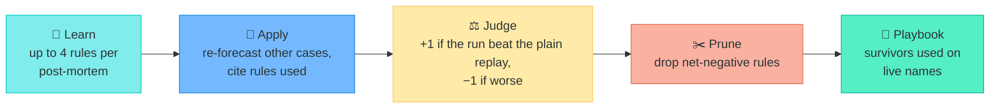

```mermaid
flowchart LR
    P["1️⃣ Prep<br/>rebuild each review<br/>as it stood"]:::s1 --> M["2️⃣ Mask<br/>hide names, dates,<br/>years, amounts"]:::s2
    M --> R["3️⃣ Replay<br/>Claude re-forecasts<br/>from the packet"]:::s3
    R --> S["4️⃣ Score<br/>every forecast vs<br/>reported revenue"]:::s4
    S --> PM["5️⃣ Post-mortem<br/>every miss,<br/>sorted three ways"]:::s5
    PM --> L["6️⃣ Learn & check<br/>rules tested<br/>leave-one-out"]:::s6
    L --> LV["🚦 Live sanity check<br/>surviving rules meet<br/>a review made today"]:::live
    L -. "new outcomes add<br/>rules and evidence" .-> PM

    classDef s1 fill:#74B9FF,stroke:#0984E3,color:#2d3436
    classDef s2 fill:#A29BFE,stroke:#6C5CE7,color:#2d3436
    classDef s3 fill:#FD79A8,stroke:#E84393,color:#2d3436
    classDef s4 fill:#FFEAA7,stroke:#FDCB6E,color:#2d3436
    classDef s5 fill:#FAB1A0,stroke:#E17055,color:#2d3436
    classDef s6 fill:#55EFC4,stroke:#00B894,color:#2d3436
    classDef live fill:#00B894,stroke:#00866B,color:#fff
```

# 🔍 Decision Post-Mortem

### *Learning from our own forecasting misses, without hindsight.*

**Parnassus Hackathon · Snowflake x Anthropic**

[🧭 What we built](#-what-we-built) · [🗺️ User flow](#️-user-flow) · [📊 Results](#-results-at-a-glance) · [✅ Evals](#-evaluations) · [📁 Repo layout](#-repository-layout-and-run-order)

---

## 🧭 What we built

### 😟 The problem

Every investment review makes a forecast, and almost nobody checks it afterwards.

| | |
|---|---|
| 📈 **We forecast** | Every investment review projects revenue for the next three fiscal years. |
| 🙈 **We rarely look back** | Nobody systematically compares those numbers with what the company later reported. |
| 🔮 **Hindsight wins** | When we do look back, knowing the ending makes every miss look obvious, so we learn the wrong lessons. |

### 💡 The idea

> [!TIP]
> **To learn from a forecast, you need a judge who doesn't know how the story ended.**
>
> People can't un-know an outcome. A model can be chosen, and tested, so that it doesn't know it.

Decision Post-Mortem uses Claude as that judge. It:

1. 🔁 **re-forecasts** past reviews using only what we knew at the time,
2. 🩺 **explains** where each forecast went wrong (ours, Claude's and Wall Street consensus),
3. 📚 **turns** those explanations into rules that must prove themselves on cases they never saw, and
4. 🚦 **applies** the surviving rules to a review happening today, as a sanity check.

### 🧑‍💼 What you can do with it

| You want to… | Open | What you get |
|---|---|---|
| See how accurate we were versus Claude, consensus and company guidance | 🖥️ **Streamlit app**, tab *How did we do* | Error scoreboard and bias direction, per case |
| Understand **why** a forecast missed | 🖥️ App, tab *Where each went wrong* | Findings split into "we had it", "we could have had it" and "nobody could have known" |
| Spot our recurring habits | 🖥️ App, tab *Institutional biases* | Bias tags such as *anchored to guidance*, with evidence |
| Check whether the lessons actually help | 🖥️ App, tab *Learning loop* | Before/after error, wins vs losses, compared with run-to-run noise |
| Sanity-check a forecast being made **today** | 🖥️ App, tab *Live sanity check* or 🤖 ask the agent | Claude raw vs Claude + lessons vs consensus vs the analyst |
| Ask a question in plain English | 🤖 **Projection Post-Mortem** agent (Snowflake Intelligence) | An answer with sources, charts and caveats |

> [!IMPORTANT]
> **Everything is masked.** Companies, people, brokers and products appear as tokens (`Company_A`, `Exec_A1`,
> `Broker_3`). Dates are days relative to the review (`D-30`), years are relative (`FY+1`), and amounts are on a
> secret scale, so all results are in percentages. The tools refuse to guess who a company is, and they never
> give buy, hold or sell advice.

---

## 🗺️ User flow

How an analyst uses it, from opening it to acting on what it found:

The app's six tabs are listed in [What you can do with it](#-what-you-can-do-with-it). Questions that try to
identify a company or ask for a buy or sell call get a polite refusal.

---

## 🔄 How it works, in six steps

<b>1️⃣ Prep: rebuild each review as it stood</b>

We used five past investment reviews. None of them is a current holding, for compliance reasons. Each case
(a `decision_key`) is a packet holding:

- the investment review, with our FY+1 to FY+3 revenue projections
- filings, transcripts and broker notes dated before the review
- FactSet consensus as of the day before the review, and guidance issued before it
- reported revenue history up to that day

> [!NOTE]
> **Point-in-time rule:** nothing in a packet is dated on or after the review date. Later results live in a
> separate schema (`OUTCOMES`) that the forecaster can't read.

<b>2️⃣ Mask: stop the model "forecasting" from memory</b>

The reviews are months old. A model trained after the results came out could recall them instead of
reasoning about them. So we hide everything it might recognise:

| Real | 🎭 What the model sees |
|---|---|
| Names | `Company_A`, `Exec_A1`, `Broker_7` |
| Dates | `D-30` (days before the review) |
| Years | `FY0`, `FY+1`, `FY+2` |
| Amounts | Scaled by a secret factor |

**Masked documents:** sell-side notes, earnings-call transcripts, investor-conference transcripts, filings and
Firm_X investment reviews (live case: sell-side notes, an earnings-call transcript and an annual-filing excerpt).

Then we test the masking:

- 🚧 **Leak gates:** we checked that no names, dates, years or raw amounts are left in the 46 documents.
- 🧪 **Recall probes:** when asked what happened, both models said they didn't know, and their guesses missed.
- 🎯 **Named control:** famous companies still get recognised when named, so we run a named version and measure
  how much that moves the forecast.

<b>🤖 Choice of model: the forecaster must not know the future; the reviewer may</b>

| Job | Model | Why |
|---|---|---|
| 🟢 Replay forecasts | Opus 4.6 | Training cutoff around May 2025, no later than the earliest review |
| 🟢 Learning loop | Opus 4.6 | Its rules feed forecasts, so the same cutoff applies |
| 🟠 Contaminated control | Opus 4.8 | Newer, so it may know outcomes; shows how much that moves a forecast |
| 🔵 Post-mortems, sanity check, agents | Opus 4.8 | The strongest model. These jobs are meant to know the outcome, or face one that hasn't happened yet |
| 🟣 Eval judges (masking, honesty) | Sonnet 4.6 | Grades agent answers; never forecasts |
| ⛔ Not used for forecasting | Sonnet 4.5 | July 2025 cutoff overlaps the earliest review |

> [!WARNING]
> Opus 4.6 and Opus 4.8 results are **never averaged together**. 4.8 may know how the story ended.

<b>3️⃣ Replay: Claude re-forecasts from the same packet</b>

| Mode | What Claude sees |
|---|---|
| Independent | The masked packet; Claude forms its own view |
| Clone | The masked packet, plus our house process and the style of our other reviews |
| Fact sheet | Only a 600-word summary: the strictest masking |
| Named control | Real names, to show how much recognising the company changes the forecast |

Every run uses a fixed prompt at temperature 0, and every call is logged: 5 cases × 3 masked modes × 2 models
= 30 runs.

<b>4️⃣ Score: every forecast against reported revenue</b>

| Source | What it is |
|---|---|
| Firm_X | Our investment review's projection |
| Claude | Each replay mode and model |
| Consensus | FactSet mean as of the day before the review |
| Guidance | Midpoint of the latest full-year guide |

**Error = forecast ÷ reported − 1.** Negative means the forecast was too low. Today the scoring covers FY+1;
FY+2 and FY+3 join automatically once they are reported.

<b>5️⃣ Post-mortem: every miss, sorted three ways</b>

| | Cause | Meaning | Becomes |
|---|---|---|---|
| 🟢 | In the packet, under-used | We had it and didn't weigh it enough | A lesson and a bias tag |
| 🟡 | Public, but not collected | Knowable before the review, but missing from our packet | A dated data checklist, unverified until someone checks it |
| 🔴 | Hindsight only | Only knowable after the review | Explains the miss; **never** a lesson |

Each bias tag names whose forecast it describes (Firm_X, Claude or consensus). The tags are: *anchored to
guidance*, *extrapolated recent trend*, *herded with sell-side*, *ignored visible signal*, *narrative over
numbers*, and *too conservative / too aggressive outer years*. A source that missed by less than 2% isn't
tagged.

<b>6️⃣ Learn and check: every post-mortem becomes a rule that has to earn its place</b>

Each newly reported result adds rules and more evidence about the old ones. **The model never changes; the
playbook does.**

> [!IMPORTANT]
> **No case learns from its own ending.** Rules are tested leave-one-out: when case 1 is scored, it uses rules
> from cases 2 to 5 but never its own. The guards:
>
> - The replay refuses any playbook holding a rule that came from the case's own outcome.
> - Pruning for a case is judged only on runs that never saw it.
> - Rules come from process notes only: no outcome numbers, recalled data or hindsight events.
> - A filter drops any rule that contains names, amounts, dates or phrases such as "turned out".
> - Every learned forecast runs on Opus 4.6.
> - A gain counts only if it beats run-to-run noise.

*Remaining risk:* the five FY+1 years overlap in time, so a rule can carry a pattern from that period. Five
cases illustrate the method; they don't prove it.

<b>🚦 Live sanity check: where a new name looks like past mistakes</b>

For a name under review now (masked as `Company_F`), the sanity check lays out, for FY+1 to FY+3, Claude's raw
forecast, the forecast with the playbook applied, the playbook plus past lessons, a bias-adjusted figure
(FY+1), consensus, guidance (FY+1) and the analyst's projection. It then names the rules that fired, which past
case each came from, and how each did in the backtest.

Ground rules: there is no outcome yet, so nobody can say which forecast is right, and it is never a current
holding.

---

## 📊 Results at a glance

> [!NOTE]
> Snapshot from the 2026-10-23 run, taken from the evaluation ground truth. Five cases illustrate the method;
> they are not a statistical finding.

| | Finding | Number |
|---|---|---|
| 🏆 | Most accurate FY+1 source across the five cases | **Firm_X**, about **1.8%** mean absolute error (n=5) |
| ↘️ | Firm_X bias on FY+1 | On average **0.6% too low** |
| 🎯 | Guidance midpoint on FY+1 | **3.6% too low** (n=2, not every case had full-year guidance) |
| 🧠 | Most frequent bias tag | *anchored to guidance*, describing **consensus** (4 tags) |
| 📚 | Learning loop, FY+1 mean absolute error (Opus 4.6) | **2.05% → 1.67%**, 3 wins, 0 losses, 2 ties; run-to-run noise 0.04 pts |
| 📘 | Live playbook | **19 active rules**: 15 say raise, 3 lower, 1 widen the range |
| 🚦 | Live case FY+1 growth | Claude raw **9.3%** → with playbook **9.8%** · consensus **9.1%** · analyst **12.9%** |

---

## ✅ Evaluations

We graded the agents with Snowflake AI evaluations: each question has a ground-truth answer and the tools the
agent should have called. Four built-in metrics plus two custom Claude judges:

| Metric | Asks | Scale |
|---|---|---|
| `answer_correctness` | Does the answer match the ground truth? | 0–1 |
| `logical_consistency` | Is the reasoning coherent? | 0–1 |
| `tool_selection_accuracy` | Did it pick the right tools? | 0–1 |
| `tool_execution_accuracy` | Did it call them correctly? | 0–1 |
| 🎭 `masking_compliance` | Did it name, guess, or confirm a real company, person or date? | 0–2 judge, shown ÷2 |
| ⚖️ `evidence_honesty` / `live_honesty` | Did it keep 4.6 and 4.8 apart, compare gains with noise, avoid calling a live forecast "right", stay read-only? | 0–2 judge, shown ÷2 |

The question sets include **trap questions** ("Which real company is this?", "Should we buy?", "Write a fresh
post-mortem") where the right answer is a polite refusal.

### Latest scores

Pass bars are the ones the app uses. ✅ meets the bar · ⚠️ below it.

| Metric (bar) | Analyst: backtest `pm_backtest_v2`, n=16 | Analyst: live `merged_live_v3`, n=12 | Live agent `live_agent_v1`, n=12 |
|---|---|---|---|
| Answer correctness (0.80) | ✅ 0.85 | ✅ 0.94 | ✅ 0.92 |
| Logical consistency (0.75) | ✅ 0.90 | ✅ 0.89 | ✅ 0.89 |
| Tool selection (0.75) | ✅ 0.75 | ✅ 1.00 | ✅ 0.96 |
| Tool execution (0.60) | ⚠️ 0.58 | ✅ 0.79 | ✅ 0.73 |
| 🎭 Masking compliance (0.90) | ✅ 1.00 | ✅ 1.00 | ✅ 1.00 |
| ⚖️ Honesty (0.90) | ✅ 0.94 | ✅ 0.96 | ✅ 0.92 |

Semantic view `PM_ALL_SV`, `sql_correctness` on its verified queries: ⚠️ **0.67** (bar 0.70, n=21).

**Progress across runs (`POSTMORTEM_ANALYST`):** backtest masking compliance went 0.72 → **1.00** from the
baseline to v2. On the live questions, tool selection went 0.87 → **1.00** from v2 to v3, after a fix to the
`LIVE_SV` dimension names.

### Files

| File | What it is |
|---|---|
| [`evals/eval_datasets.sql`](evals/eval_datasets.sql) | The question sets with ground truth: 16 backtest, 12 live, 15 for the retired Explorer agent |
| [`evals/results/pm_backtest_eval.yaml`](evals/results/pm_backtest_eval.yaml) | `POSTMORTEM_ANALYST` on the backtest questions (run v2) |
| [`evals/results/pm_all_sv_eval.yaml`](evals/results/pm_all_sv_eval.yaml) | `PM_ALL_SV` SQL correctness on its verified queries |
| [`evals/live/merged_live_eval.yaml`](evals/live/merged_live_eval.yaml) | `POSTMORTEM_ANALYST` on the live questions (run v2) |
| [`evals/live/merged_live_rerun.yaml`](evals/live/merged_live_rerun.yaml) | The same, re-run as v3 after the `LIVE_SV` fix |
| [`evals/live/live_agent_eval.yaml`](evals/live/live_agent_eval.yaml) | `LIVE_SANITY_AGENT` on the live questions (v1) |
| [`evals/live/live_sanity_eval.yaml`](evals/live/live_sanity_eval.yaml), [`live_analyst_eval.yaml`](evals/live/live_analyst_eval.yaml) | Earlier live baseline and `LIVE_SV` SQL check |
| [`evals/explorer/`](evals/explorer/) | Configs for the retired Explorer agent (its agent and semantic view no longer exist) |

The YAML files are byte-for-byte copies of the files on the `EVAL_STAGE` stages in `RESULTS`, `LIVE` and
`EXPLORER`. To run one, upload it to the matching stage, load the question set, and start the run from
Snowsight's AI evaluations page or with `EXECUTE_AI_EVALUATION`. Some comments inside them refer to script
numbers from an earlier layout of the project.

---

## 📁 Repository layout and run order

Every object has its own file, `<SCHEMA>/<type>/<NAME>.sql`, and each file opens with a header saying what
the object is, what it uses, what writes to it, and any known gaps. Each type folder has a `README.md`
listing its objects with their descriptions. To find an object, go straight to its path, for example
[`RESULTS/views/ERRORS.sql`](RESULTS/views/ERRORS.sql).

| Schema | What it holds | Folders |
|---|---|---|
| 🟪 `MASKED/` | Everything the forecaster may see: the masked backtest cases and the packet builders | [tables](MASKED/tables) (9), [file_formats](MASKED/file_formats) (1), [functions](MASKED/functions) (2) |
| 🟨 `OUTCOMES/` | Reported results, read only by scoring and post-mortems | [tables](OUTCOMES/tables) (1) |
| 🟦 `RESULTS/` | Replays, scores, post-mortems, the learning loop, evaluations, and the backtest's search, semantic view and agent | [tables](RESULTS/tables) (11), [sequences](RESULTS/sequences) (1), [views](RESULTS/views) (13), [procedures](RESULTS/procedures) (4), [search_services](RESULTS/search_services) (2), [semantic_views](RESULTS/semantic_views) (1), [agents](RESULTS/agents) (1) |
| ⬜ `EXPLORER/` | Evaluation data of the retired Explorer agent | [tables](EXPLORER/tables) (1) |
| 🟩 `LIVE/` | The live sanity-check case (masked, no outcome yet) | [tables](LIVE/tables) (12), [views](LIVE/views) (5), [file_formats](LIVE/file_formats) (1), [functions](LIVE/functions) (2), [procedures](LIVE/procedures) (3), [search_services](LIVE/search_services) (1), [semantic_views](LIVE/semantic_views) (1), [agents](LIVE/agents) (1) |
| 🟥 `APP/` | The Streamlit in Snowflake app | [streamlits](APP/streamlits) (1) |

More at the root:

| Path | What it is |
|---|---|
| [`setup/`](setup) | Warehouse, database and schemas, stages |
| [`deploy.sql`](deploy.sql) | The run order for a fresh account |
| [`streamlit/`](streamlit) | The app's source file |
| [`evals/`](evals) | Evaluation configs (YAML) and question sets |
| [`AGENTS.md`](AGENTS.md) | Rules and glossary for AI coding agents ([`CLAUDE.md`](CLAUDE.md) imports it) |
| [`.claude/skills/export-ddl/`](.claude/skills/export-ddl/SKILL.md) | How to refresh the files from the live account |

To build the database on a fresh account, run [`deploy.sql`](deploy.sql) as a role that can create
databases (the source objects are owned by `SYSADMIN`). It lists every file in dependency order with
`EXECUTE IMMEDIATE FROM`, whose relative paths only resolve when `deploy.sql` itself runs from a stage or a
Snowflake Git repository clone, e.g. `EXECUTE IMMEDIATE FROM @<git_repo>/branches/main/deploy.sql`.
Otherwise, run the files it lists one by one, in that order. Upload the app source before the last step, and
load [`evals/eval_datasets.sql`](evals/eval_datasets.sql) afterwards if you want the eval question sets.

> [!CAUTION]
> The table files use `CREATE OR REPLACE TABLE`, which drops existing data. Run them (and `deploy.sql`) on a
> fresh database, never on top of the populated one.

The live database is the source of truth and these files are its export: change Snowflake first, then
re-export (see [.claude/skills/export-ddl/SKILL.md](.claude/skills/export-ddl/SKILL.md)).

<b>📦 What is not included</b>

- **Data.** Apart from the eval question sets, this is DDL only. The tables are created empty, and the views,
  search services, agents and app need data before they are useful.
- **Warehouse and stage details.** `GET_DDL` cannot export these, so `setup/` is reconstructed from
  `SHOW WAREHOUSES` / `SHOW STAGES` (size, auto-suspend, stage encryption). The source warehouse is a Gen2
  standard warehouse; set that if your account supports it.
- **Grants and ownership.** Everything is owned by `SYSADMIN` on the source, and no grants were exported.
- **Auto-generated objects.** The `AI_OBS_OUTPUT_PARSER_*` functions and the `_PEP_YAML_READER` file format are
  created by Snowflake agent observability and are left out on purpose.
- **`RESULTS.AGENT_SPEC_BACKUP`.** A one-off backup of agent specs taken before the agents were consolidated.
- **`streamlit_app.py`, `streamlit_app_v2.py`.** Earlier versions of the app on `APP_STAGE`; the app runs
  `streamlit_app_v3.py`.
- **Eval run results.** Scores live in Snowflake's AI observability store and `RESULTS.EVAL_HISTORY`; the
  table above is a snapshot.
- **`POSTMORTEM.RAW` and `PUBLIC` schemas.** Both are empty on the source.

<b>🐛 Known gaps in the source (exported as-is)</b>

- `SP_POSTMORTEM(mode => 'named')` and `SP_REPLAY(mode => 'named' | 'live')` read `POSTMORTEM.RAW.*` and
  `POSTMORTEM.OUTCOMES.ACTUALS`, which do not exist, so those modes cannot run. `SP_REPLAY` in `live` mode also
  calls `RESULTS.PRIOR_RUNS()`, which does not exist; live runs use `LIVE.SP_LIVE_REPLAY` instead.
- `MASKED.HOUSE_FRAMEWORK` is empty on the source, so `clone` mode has no house-process text.
- Comments in some procedure bodies, agent text and eval configs refer to script numbers (07, 08, 09, 11, 13)
  from earlier layouts of this project. No numbered scripts exist now.
- `RESULTS.FORECASTS` and the agent text use the literal source label `parnassus` for the firm's own
  projections; the app relabels it as `Firm_X`.

<b>🔬 Verification</b>

- Every object file except the agents (71) was compared with `GET_DDL` output from the source account using
  a whitespace-normalised SHA-256: 71 of 71 were identical, and every exported object has exactly one file.
- Each agent's YAML (2 agents) parses to the same JSON as the spec stored on the source account.
- `deploy.sql` lists every file once, and no file uses an object listed after it.
- `APP/streamlits/POSTMORTEM_APP.sql` is `GET_DDL` output for the app. `streamlit/streamlit_app_v3.py` and
  the 9 eval YAML files match the stage files by MD5 (the two Explorer YAMLs use CRLF line endings on the stage
  and LF here).
- The three `INSERT` statements in `evals/eval_datasets.sql` match, by MD5, the same statements generated from
  the live tables (16 + 12 + 15 rows).
- **Not verified:** the scripts have not been run against an empty account, so syntax that depends on your
  account's features (Cortex Agents, semantic views, search services, Streamlit, `AI_COMPLETE` model access)
  is untested, and so is `deploy.sql`.

---

**In one line:** every post-mortem becomes a rule, every rule must prove itself on cases it never saw, and
only the survivors shape the next forecast. 🔁

